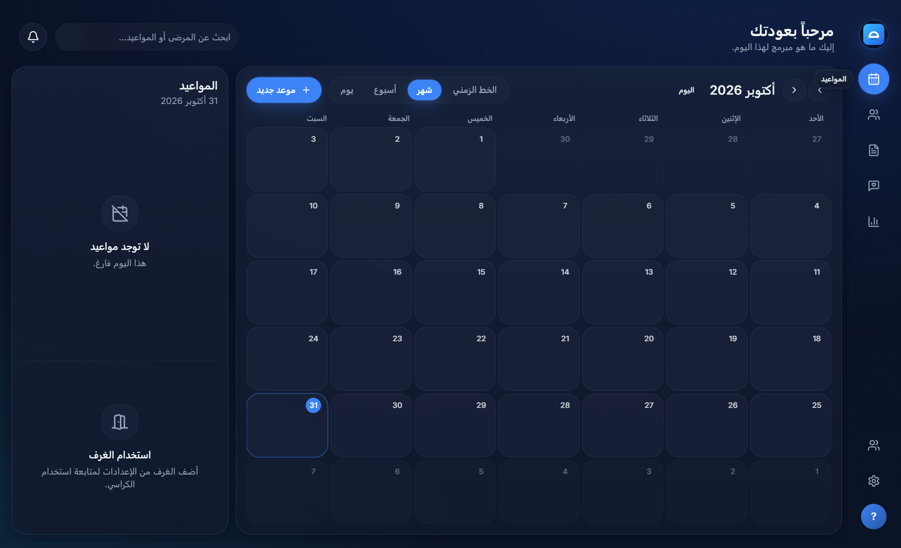

  

<h1 align="center">ClinicFlow</h1>

  <strong>Modern desktop software for dental &amp; medical clinics</strong> 
  Appointments · Patients · Prescriptions · WhatsApp reminders

  
  
  

  <a href="https://github.com/MohOneX/ClinicFlow-Releases/releases/download/v1.1.0/ClinicFlow-Setup-1.1.0.exe"><strong>⬇ Download ClinicFlow Setup 1.1.0 (Windows x64)</strong></a>

---

## Overview

**ClinicFlow** helps clinics run the daily floor with one focused desktop app: schedule visits, open a patient’s chart, write branded prescriptions, and send Arabic WhatsApp reminders — without juggling spreadsheets or separate tools.

This repository hosts **official installers only**. Application source code is maintained privately.

---

## Screenshot

---

## What’s included in v1.1.0

| Area | Highlights |
|------|------------|
| **Calendar** | Day / Week / Month / Timeline views, drag-friendly blocks, scheduled list |
| **Patients** | Schedule-by-date sidebar, chart with history, notes, and prescriptions |
| **Reminders** | Appointment / recall / follow-up templates with WhatsApp send from the chart |
| **Prescriptions** | Favorites, letterhead templates, signature, print & PDF |
| **Locales** | English & Arabic UI |

---

## System requirements

- **OS:** Windows 10 or Windows 11 (**64-bit**)
- **Disk:** ~200 MB free for install
- **Optional:** WhatsApp Desktop or WhatsApp Web for sending reminders

---

## Install

1. Open the [**latest Release**](https://github.com/MohOneX/ClinicFlow-Releases/releases/latest).
2. Download **`ClinicFlow-Setup-1.1.0.exe`**.
3. Run the installer and follow the prompts (you can choose the install folder).
4. Launch **ClinicFlow** from the Start Menu or desktop shortcut.

> Windows may show a SmartScreen prompt for unsigned builds. Choose **More info** → **Run anyway** if you trust this download.

### Direct download (v1.1.0)

[ClinicFlow-Setup-1.1.0.exe](https://github.com/MohOneX/ClinicFlow-Releases/releases/download/v1.1.0/ClinicFlow-Setup-1.1.0.exe)

---

## Updating

Download the newer Setup from [Releases](https://github.com/MohOneX/ClinicFlow-Releases/releases) and install over the previous version. Clinic data stays on your PC.

---

## Support

Questions about installing or using ClinicFlow? Open an [issue](https://github.com/MohOneX/ClinicFlow-Releases/issues) on this repository.

---

## License & ownership

ClinicFlow © 2026. This releases repository redistributes official Windows installers. Source code and trademarks remain private property of the ClinicFlow author. Redistribution of the installer without permission is not allowed.
